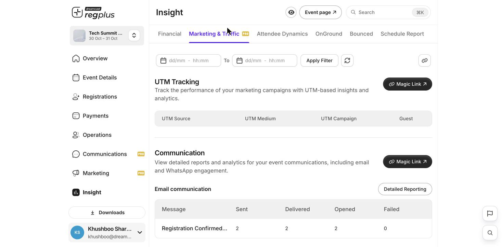

The **Marketing & Traffic** report under **Insight** shows which campaigns are bringing people to your event and how your messages are landing. Open **Insight → Marketing & Traffic** to see it.

<Frame caption="The Marketing & Traffic report — UTM tracking and communication stats.">
  
</Frame>

## UTM Tracking

If you share your event link with UTM tags, this table tells you how each campaign is doing. It breaks guests down by **UTM Source**, **UTM Medium** and **UTM Campaign**, so you can see which post, email or ad actually brought registrations.

| Column | What it tells you |
| --- | --- |
| **UTM Source** | Where the link lived — newsletter, instagram, google. |
| **UTM Medium** | The channel type — email, social, cpc. |
| **UTM Campaign** | The campaign name you set. |
| **Guests** | How many registrations that link brought. |

## Communication

| Section | What it shows |
| --- | --- |
| **Email communication** | For each message sent (confirmations, reminders…), how many were **Sent**, **Delivered**, **Opened** and **Failed**. **Detailed Reporting** goes deeper. |
| **WhatsApp communication** | The same breakdown for WhatsApp messages. |

## Filter by date

Use the date range at the top and click **Apply Filter** to focus on a period.

<Tip>
  Add UTM tags to your event link whenever you promote it — social, newsletter, ads. Without them, this report can't tell which channel a registration came from. Generate them in [Marketing → Campaign tracking](/regplus/how-to-marketing).
</Tip>

## FAQs

<AccordionGroup>
  <Accordion title="My UTM table is empty.">
    You're sharing the plain event link. Generate **UTM links** in the Marketing module and share those instead, so each channel is tagged.
  </Accordion>

  <Accordion title="Lots of emails show as Failed.">
    Those addresses bounced. Cross-check the **Bounced** report and clean bad addresses from your guest list.
  </Accordion>
</AccordionGroup>

## What's next?

<CardGroup cols={2}>
  <Card title="Promote & track your event" icon="bullhorn" href="/regplus/how-to-marketing">
    Create the UTM links and pixels this report reads.
  </Card>

  <Card title="Attendee dynamics" icon="users" href="/regplus/insight-attendee-dynamics">
    See how registrations trend over time.
  </Card>
</CardGroup>
