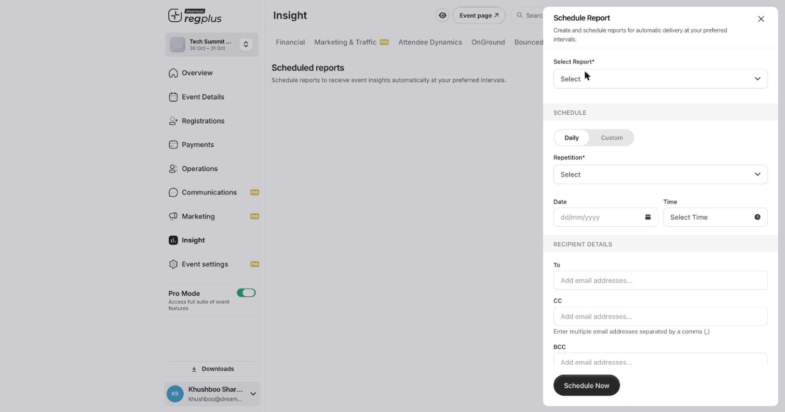

Instead of opening the dashboard every day, you can have regplus email your reports to you on a schedule. Open **Insight → Schedule Report** and click **Schedule New**.

<Frame caption="The Schedule Report form — report, schedule and recipients.">
  
</Frame>

## Set up a scheduled report

| Field | What to set |
| --- | --- |
| **Select Report** | Which report to send (Financial, Attendee Dynamics, and so on). |
| **Daily / Custom** | A daily cadence, or your own pattern with **Custom**. |
| **Repetition** | How often it repeats. |
| **Date / Time** | When the first report goes out, and at what time. |
| **To / CC / BCC** | Who receives it — separate multiple addresses with a comma. |

Click **Schedule Now**. From then on, the report lands in those inboxes automatically at the interval you set, with no need to log in.

<Tip>
  Add your finance or leadership team to the **CC** field so they get the numbers directly, without needing backend access.
</Tip>

## FAQs

<AccordionGroup>
  <Accordion title="Can I send different reports to different people?">
    Yes — schedule each report separately, with its own recipients and cadence.
  </Accordion>

  <Accordion title="How do I stop a scheduled report?">
    Open the **Schedule Report** tab and remove or edit the schedule you set up.
  </Accordion>

  <Accordion title="Can I just share a live link instead?">
    Yes — every report has a **Magic Link** for a live, read-only view, as an alternative to scheduled emails.
  </Accordion>
</AccordionGroup>

## What's next?

<CardGroup cols={2}>
  <Card title="Insights & reports" icon="chart-line" href="/regplus/insights-reports">
    See all the reports you can schedule.
  </Card>

  <Card title="Export your data" icon="file-export" href="/regplus/exports">
    Download a one-off file instead.
  </Card>
</CardGroup>
