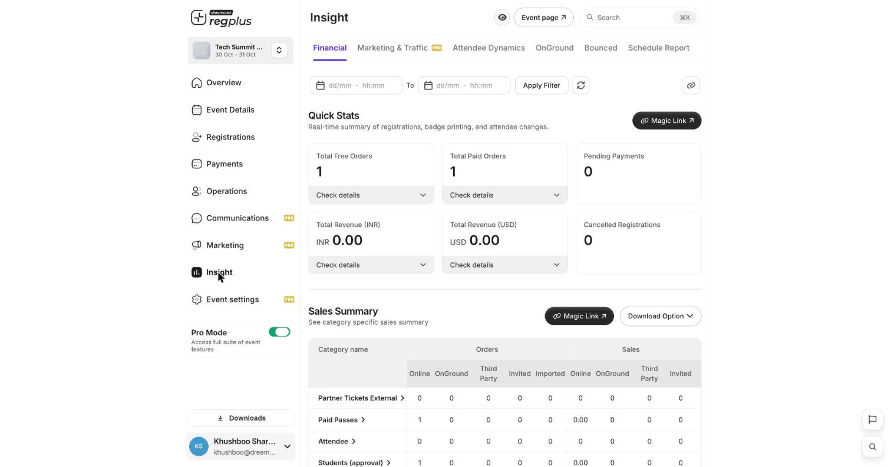

**In short:** Your **Overview** shows the headline numbers at a glance. The **Insight** section goes deeper — a separate report for money, people, traffic, on-ground and bounced orders, each filterable by date and shareable as a live link.

## The Overview

The Overview shows live counts for your event — registrations, checked-in, total orders and revenue — plus a setup checklist.

<Frame caption="The Overview — your headline numbers.">
  
</Frame>

## The Insight reports

Open **Insight** for the full picture. Each report sits on its own tab:

<Frame caption="An Insight report — quick stats and a breakdown.">
  
</Frame>

| Report | What it shows |
| --- | --- |
| **Financial** | Orders, revenue and sales by ticket type and channel. See [Financial report](/regplus/insight-financial). |
| **Marketing & Traffic** | Where registrations came from (UTM) and how messages performed. See [Marketing & Traffic](/regplus/insight-marketing). |
| **Attendee Dynamics** | Registrations, redemptions, transfers and trends. See [Attendee Dynamics](/regplus/insight-attendee-dynamics). |
| **OnGround** | Check-in and scan activity on event day. |
| **Bounced** | Orders that failed or were reversed. See [Bounced](/regplus/insight-bounced). |
| **Schedule Report** | Have reports emailed to you automatically. See [Schedule Report](/regplus/insight-schedule-report). |

<Tip>
  Every report has a **date filter** and a **Magic Link** — a live, read-only link you can send to a colleague or client so they always see the latest numbers without a backend login.
</Tip>

## FAQs

<AccordionGroup>
  <Accordion title="My numbers look off.">
    Check the **date filter** at the top of the report — if a range is applied you're only seeing that window. Clear or widen it.
  </Accordion>

  <Accordion title="How do I share a report without giving someone access?">
    Use the **Magic Link** on the report — it's a live, read-only view, no login needed.
  </Accordion>

  <Accordion title="Can I get a report automatically?">
    Yes — use **Schedule Report** to have it emailed on a daily or custom schedule.
  </Accordion>
</AccordionGroup>

## What's next?

<CardGroup cols={2}>
  <Card title="Read your Insight reports (detailed)" icon="chart-line" href="/regplus/how-to-insight-reports">
    The full walkthrough of every report.
  </Card>

  <Card title="Export your data" icon="file-export" href="/regplus/exports">
    Download your lists and reports.
  </Card>
</CardGroup>
