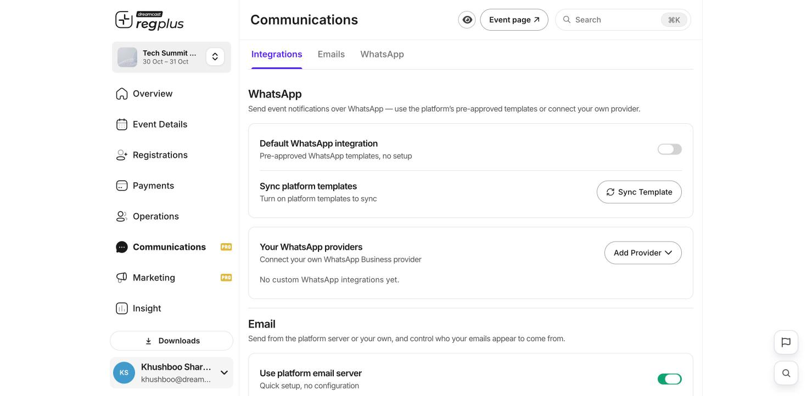

**In short:** Before you send any invites, reminders or confirmations, decide how they go out. Under **Communications → Integrations** you set up two channels — WhatsApp and email — and choose whether to use regplus's built-in service or connect your own.

<Frame caption="The Integrations tab — WhatsApp and email setup.">
  
</Frame>

## WhatsApp

Send confirmations, reminders and updates to your guests over WhatsApp.

| Option | What it does |
| --- | --- |
| **Default WhatsApp integration** | Turn on to use regplus's pre-approved templates — nothing to set up; messages go from the platform's number. |
| **Sync Template** | Once the default integration is on, pull in the ready-made templates so they're available for your event. |
| **Your WhatsApp providers** | Prefer your own WhatsApp Business number? Click **Add Provider** and connect it. Until you do, your event uses the default integration. |

## Email

Send from regplus's email server or your own, and control the name and address guests see.

| Option | What it does |
| --- | --- |
| **Use platform email server** | Keep on for the quickest start — emails go through regplus's server with no setup. Turn off only to send through your own service. |
| **Sender identity** | Set the **Sender Name** (and address) so guests can tell at a glance who the email is from. |

<Tip>
  For most events, leaving both channels on the default platform settings is enough to get started. Connect your own provider only when you need emails or WhatsApp messages to come from your own number or domain.
</Tip>

## FAQs

<AccordionGroup>
  <Accordion title="Do I need my own WhatsApp number?">
    No — the **Default WhatsApp integration** uses pre-approved templates with no setup. Add your own provider only if you want messages from your own number.
  </Accordion>

  <Accordion title="How do I make emails come from my domain?">
    Turn off **Use platform email server**, configure your own email service, and set your **Sender identity**.
  </Accordion>

  <Accordion title="I turned on WhatsApp but no templates appear.">
    Click **Sync Template** after enabling the default integration to pull the templates in.
  </Accordion>
</AccordionGroup>

## What's next?

<CardGroup cols={2}>
  <Card title="Emails & WhatsApp" icon="comments" href="/regplus/emails-whatsapp">
    Edit the templates and send updates.
  </Card>

  <Card title="Confirmations & reminders" icon="bell" href="/regplus/confirmations-reminders">
    Set the automatic messages guests get.
  </Card>
</CardGroup>
