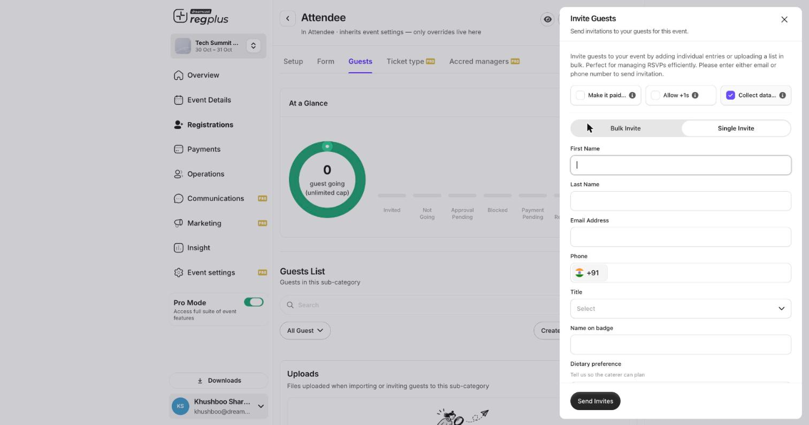
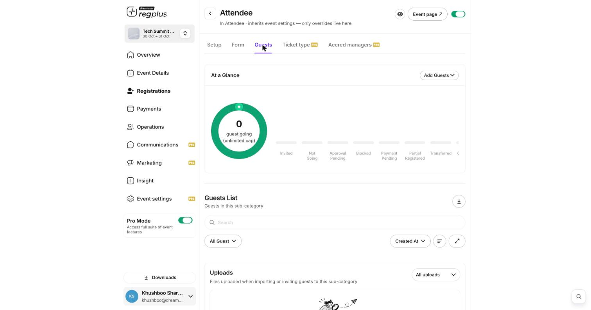

**In short:** For invite-led events, you send invites and track who's coming. Guests are **Invited** until they respond, then show as confirmed or **Not Going** — and can bring a guest if you allow it.

<Info>
  **Where to find it:** Open **Registrations**, click **Manage** on a ticket type, go to the **Guests** tab, and use **Add Guests → Invite**.
</Info>

## Invite a guest

<Frame caption="The Invite Guests panel — single or bulk, with +1 and data options.">
  
</Frame>

| Field or toggle | What it does |
| --- | --- |
| **Single / Bulk Invite** | Add one guest by hand, or paste/upload a whole list. |
| **Make it paid** | Send a paid invite (the guest pays when they accept) or leave off for a free, complimentary invite. |
| **Allow +1s** | Let the guest bring additional people. |
| **Collect data** | Have the guest fill your registration form when they accept; turn off for a name-and-email-only invite. |
| **First / Last name, Email, Phone** | The guest's details — enter at least an email or phone. |

Click **Send Invites** to fire the invitations.

## Invite many people at once

Switch to **Bulk Invite** to upload a list and invite everyone together. Every file you import or invite from is kept under **Uploads** at the bottom of the Guests tab.

## Watch replies come in

<Frame caption="The guest list shows where everyone stands.">
  
</Frame>

Each guest shows as **Invited** until they respond. The status summary at the top of the Guests tab counts Invited, Not Going, Approval Pending and more, so you always know your headcount.

<Note>
  Invites go to real people by email or WhatsApp. Turn on **Collect data** only if you need the full form — the shorter the invite, the more people accept. Send yourself a test invite first.
</Note>

## FAQs

<AccordionGroup>
  <Accordion title="How do I let guests bring a friend?">
    Turn on **Allow +1s** when you invite them. You can cap how many each guest may add.
  </Accordion>

  <Accordion title="Can I invite without making them fill the form?">
    Yes — turn **Collect data** off. The guest is added with just the details you enter.
  </Accordion>

  <Accordion title="What's the difference between Invite and Import?">
    **Invite** sends each person an invitation to accept; **Import** adds an already-confirmed list straight in. See [Manage your guest list](/regplus/how-to-manage-guests).
  </Accordion>
</AccordionGroup>

## What's next?

<CardGroup cols={2}>
  <Card title="Manage your registrant list" icon="users" href="/regplus/manage-registrants">
    Edit, transfer or cancel a guest.
  </Card>

  <Card title="Set up the Invite app" icon="user-plus" href="/regplus/how-to-invite-app">
    Let your team send invites with their own quotas.
  </Card>
</CardGroup>
