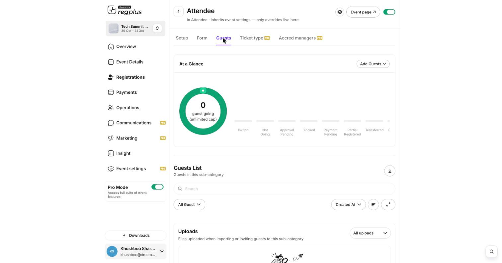

**In short:** Every person who signs up appears in your **Guests** list. From there you can find anyone, read their status, and manage their registration.

<Info>
  **Where to find it:** Open **Registrations**, click **Manage** on a ticket type, and go to the **Guests** tab.
</Info>

## Read the list

<Frame caption="The guest list — a status summary on top, the full list below.">
  
</Frame>

The **At a Glance** summary counts where everyone stands:

| Status | What it means |
| --- | --- |
| **Invited** | Invited, but hasn't registered yet. |
| **Not Going** | Declined the invite. |
| **Approval Pending** | Needs your approval before being confirmed. |
| **Payment Pending** | A paid registration that hasn't paid yet. |
| **Partial Registered** | Started but didn't finish. |
| **Blocked** | Blocked — can't check in or re-register. |
| **Transferred** | The ticket was moved to someone else. |

Use **Search** to find a person, the **All Guest** filter to show one status, and the **download** icon to export the list.

## What you can do with a guest

Open a guest from the list and use their menu (**⋮**):

| Action | What it does |
| --- | --- |
| **Edit details** | Fix a name, email or a form answer. |
| **Transfer ticket** | Move the ticket to a different person. |
| **Cancel** | Cancel the registration (this does **not** refund automatically). |
| **Block** | Stop that email or phone registering again. |
| **Approve / Reject** | For registrations sitting in Approval Pending. |

<Note>
  Cancelling a paid registration does **not** send a refund on its own. Handle any refund separately — see [Issue a refund](/regplus/how-to-issue-refund).
</Note>

## FAQs

<AccordionGroup>
  <Accordion title="A guest is stuck on Payment Pending.">
    Their payment didn't complete. Ask them to finish paying from their email link, or confirm the registration manually from their row.
  </Accordion>

  <Accordion title="How do I export everyone?">
    Use the **download** icon on the Guests tab. For an event-wide view across all ticket types, use the **Insight** reports.
  </Accordion>

  <Accordion title="Someone keeps re-registering. How do I stop them?">
    Open their row and **Block** them — their record stays but they can't register or check in again.
  </Accordion>
</AccordionGroup>

## What's next?

<CardGroup cols={2}>
  <Card title="Approvals, limits & waitlists" icon="user-check" href="/regplus/approvals-limits">
    Control who gets in and how many.
  </Card>

  <Card title="Manage your guest list (detailed)" icon="users" href="/regplus/how-to-manage-guests">
    The full walkthrough with every option.
  </Card>
</CardGroup>
