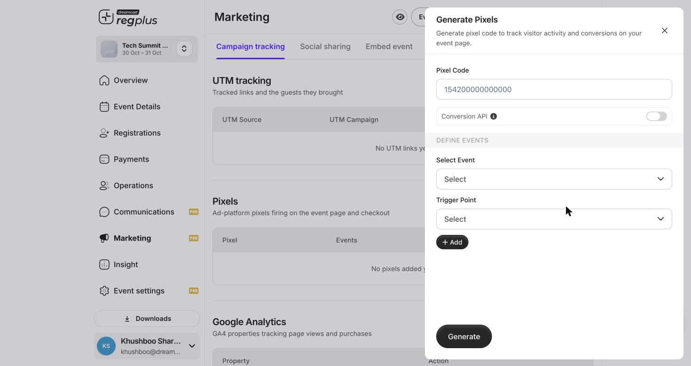

**In short:** A pixel lets you run Facebook and Instagram ads for your event and see which ads actually bring sign-ups. Add it in **Marketing → Campaign tracking → Pixels**.

<Info>
  **Before you start:** you need your **Pixel ID** from your Meta Ads account.
</Info>

## Add your pixel

Click **Add pixel** and fill in the details.

<Frame caption="The pixel form — code, Conversion API and the events to track.">
  
</Frame>

| Field | What it does |
| --- | --- |
| **Pixel Code** | Your Meta Pixel ID. |
| **Conversion API** | Turn on to also send events **server-side**, not just from the browser — far more reliable when browsers block pixels. |
| **Select Event** | Which action to report: `PageView`, `ViewContent`, `Search`, `AddToCart`, `AddToWishlist`, `Purchase`, `Lead`, `CompleteRegistration`, `Contact`, `Schedule`. |
| **Trigger Point** | Where that event fires — on the event page, or at checkout. |

Use **Add** to map more than one event (for example `PageView` on the event page and `Purchase` at checkout), then **Generate**.

<Tip>
  For accurate reporting, map **Purchase** (a completed paid registration) and turn on **Conversion API**. Browser-only pixels undercount when ad-blockers or privacy settings are active — the server-side API fills the gap and reduces double-counting.
</Tip>

<Note>
  Set up your pixel **before** you start spending on ads. If you add it later, you miss the data from the ads that already ran.
</Note>

## FAQs

<AccordionGroup>
  <Accordion title="My ad platform is undercounting registrations.">
    Turn on **Conversion API** and make sure **Purchase** is mapped to checkout — browser-only pixels miss conversions when tracking is blocked.
  </Accordion>

  <Accordion title="Which event means a completed sign-up?">
    **Purchase** for a paid registration, or **CompleteRegistration** for a free one. Map whichever matches how your event sells.
  </Accordion>

  <Accordion title="Can I also use Google Analytics?">
    Yes — add a GA4 property under **Google Analytics** on the same Campaign tracking tab.
  </Accordion>
</AccordionGroup>

## What's next?

<CardGroup cols={2}>
  <Card title="Tracking links (UTM)" icon="link" href="/regplus/tracking-links">
    Track every channel you share on.
  </Card>

  <Card title="Marketing & Traffic report" icon="chart-mixed" href="/regplus/insight-marketing">
    See what your ads bring in.
  </Card>
</CardGroup>
