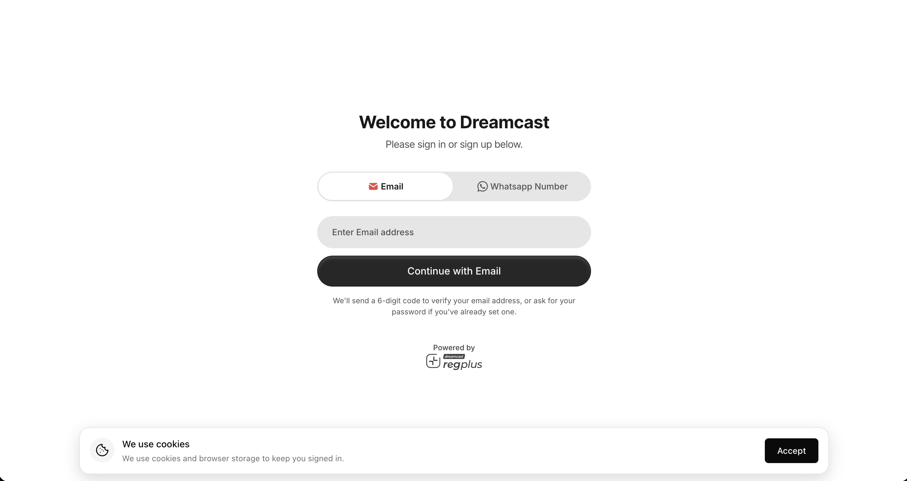
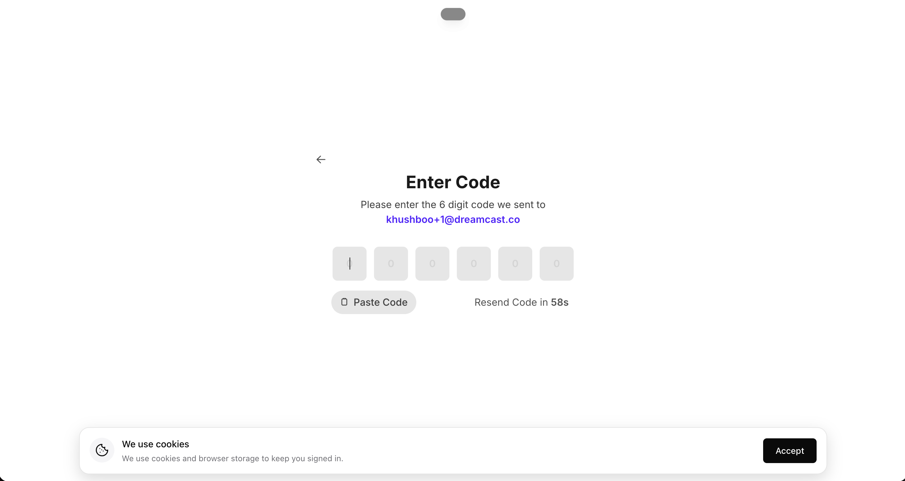
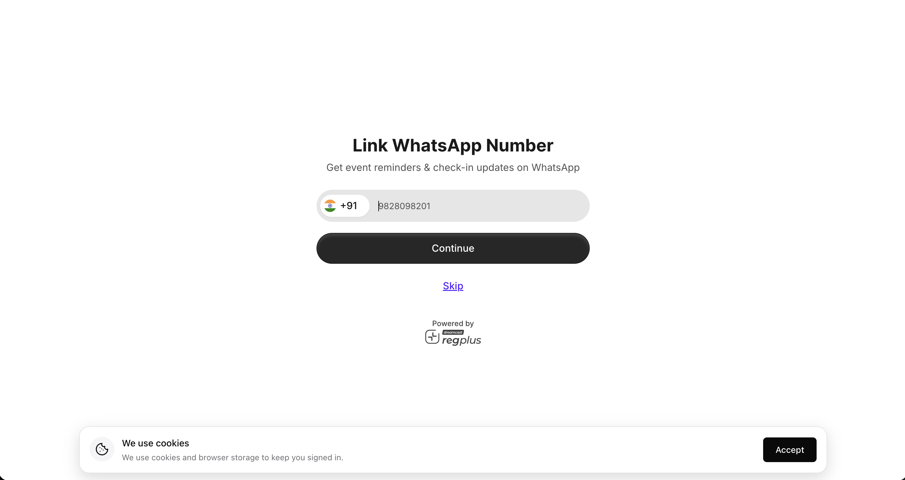
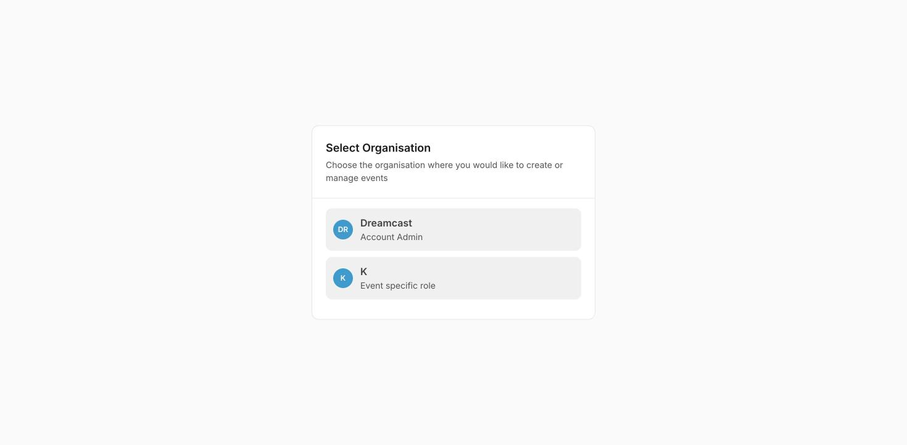

**In short:** Sign up with your email or WhatsApp number, confirm the code we send, optionally link your WhatsApp, and pick the organisation you'll manage events for. The whole thing takes under a minute, and there's nothing to install.

## 1. Sign in or sign up

On the welcome screen, choose **Email** or **WhatsApp Number**, enter it, and click **Continue**.

- **First time here?** This creates your account.
- **Already signed up?** The same screen signs you back in.

We then verify it's really you — by sending a 6-digit code, or by asking for your password if you've set one.

<Frame caption="Sign in or sign up with email or WhatsApp.">
  
</Frame>

| Field | What to do |
| --- | --- |
| **Email / WhatsApp Number** | Pick the tab you prefer and enter that address or number. |
| **Continue** | Sends the verification code (or takes you to the password step). |

## 2. Enter the verification code

Enter the 6-digit code we send to your email or WhatsApp.

<Frame caption="Enter the 6-digit verification code.">
  
</Frame>

- **Paste Code** fills all six digits in one tap.
- **Resend Code** sends a fresh code if the first doesn't arrive — check spam, or that the number is correct.

## 3. Link your WhatsApp number

Add your WhatsApp number so event reminders and check-in updates can reach you there, then click **Continue** — or **Skip** and add it later from your profile.

<Frame caption="Link your WhatsApp number, or skip for now.">
  
</Frame>

<Note>
  Linking **both** your email and WhatsApp keeps everything on one account. If you sign up with one and later sign in with the other **without** linking, you'll create a second, separate account — and your events won't be together.
</Note>

## 4. Choose your organisation

If your login can manage events for more than one organisation — or you hold an event-specific role — pick which one to work in. You land on that organisation's dashboard.

<Frame caption="Choose which organisation (and role) to work in.">
  
</Frame>

| What you see | What it means |
| --- | --- |
| **Account Admin** | Full access to that organisation — all its events, branding and team. |
| **Event specific role** | Access scoped to a single event (for example a sponsor managing just their part). |

You can switch organisations any time without signing out — see [Account & organisation](/regplus/how-to-account-org).

## Sign out

Click your name at the **bottom-left** of the dashboard to open the account menu, then **Logout**. Always sign out on a shared or public computer.

## FAQs

<AccordionGroup>
  <Accordion title="Do I need a password?">
    Not necessarily — you can sign in with a one-time code to your email or WhatsApp each time. Set a password if you'd rather use one.
  </Accordion>

  <Accordion title="The verification code didn't arrive.">
    Use **Resend Code**, check your spam folder, and make sure the email or number is typed correctly. For WhatsApp, confirm the country code.
  </Accordion>

  <Accordion title="I accidentally made two accounts.">
    That happens when you sign up with email and later sign in with WhatsApp (or vice-versa) without linking them. Link both contact methods on one account from your profile to keep everything together.
  </Accordion>

  <Accordion title="I signed in but landed on a 'Select Organisation' screen.">
    That's normal when your login has more than one organisation or an event-specific role. Pick the one you want and continue.
  </Accordion>
</AccordionGroup>

## What's next?

<CardGroup cols={2}>
  <Card title="Set up your profile" icon="user-pen" href="/regplus/how-to-account-org">
    Add your host name, photo and social links.
  </Card>

  <Card title="Create your first event" icon="calendar-plus" href="/regplus/create-your-first-event">
    Go from nothing to a live event page in minutes.
  </Card>
</CardGroup>
