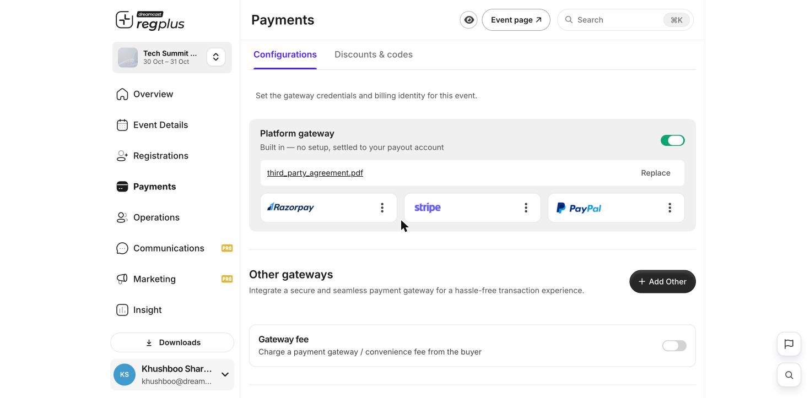
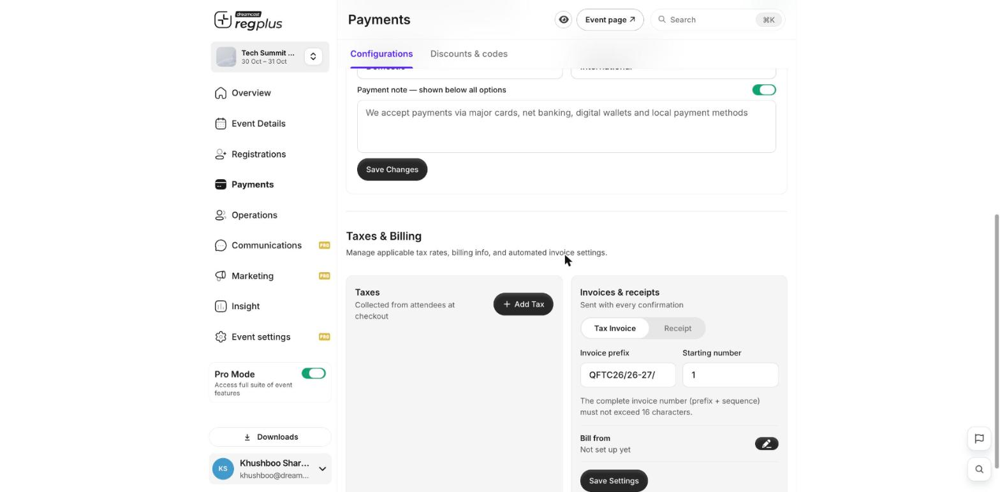

**In short:** To sell tickets, make sure payments are on for your event, then set a price on each paid ticket. You can collect through the built-in gateway or your own provider, and add taxes, fees and invoices.

<Info>
  **Where to find it:** Open **Payments** from the left menu. The **Configurations** tab holds gateways, taxes, fees and invoices.
</Info>

## Turn on payments

1. Go to **Payments → Configurations**. The built-in **Platform gateway** is on by default and settled to your payout account — that's what lets you collect money. The first time you switch it on, regplus asks you to download, sign and upload the **Pure Agent cum Professional Services Agreement** — do this once and the signed file stays on the gateway card.
2. You can also connect your own **Razorpay**, **Stripe** or **PayPal** under **Other gateways** so funds settle straight to your provider.

<Frame caption="Payment gateways — the platform gateway plus your own providers.">
  
</Frame>

| Gateway | When to use it |
| --- | --- |
| **Platform gateway** | The quickest option — on by default, settled to your payout account. |
| **Razorpay / Stripe / PayPal** | Connect your own account so money lands directly with your provider. See the detailed setup guides for [Razorpay](/regplus/how-to-setup-razorpay), [Stripe](/regplus/how-to-setup-stripe) and [PayPal](/regplus/how-to-setup-paypal). |

## Set a price

Go to **Registrations**, open a ticket option, switch on **Paid**, enter the amount, and click **Save Changes**. (Full detail in [Ticket types & pricing](/regplus/ticket-types).)

## Checkout text

Turn on **Checkout text** to control what guests read around the payment options — the **Domestic** and **International** section labels, and a **Payment note** shown below all methods. Full detail in [Configure payments & taxes](/regplus/how-to-configure-payments).

## Taxes, fees and invoices

Under **Payments → Configurations** you can fine-tune how money is charged and documented:

<Frame caption="Taxes, fees and invoice settings.">
  
</Frame>

| Setting | What it does |
| --- | --- |
| **Add tax** | GST, VAT or another type, with a rate (%) that applies to the ticket types you choose. |
| **Gateway fee** | Decide whether you **absorb** the payment fee or **pass it to the guest** at checkout. |
| **Invoices** | Choose a tax invoice or receipt, with your invoice prefix, starting number and billing details. |

<Note>
  Before you share your link, open your event page and check the amount shown at checkout matches the price you set — including any tax or fee you added.
</Note>

## FAQs

<AccordionGroup>
  <Accordion title="Do I have to connect my own gateway?">
    No — the **Platform gateway** works out of the box. Connect Razorpay, Stripe or PayPal only if you want funds to settle directly with your own provider.
  </Accordion>

  <Accordion title="Should I absorb the fee or pass it on?">
    Passing it on keeps your ticket price clean but adds a line at checkout; absorbing it keeps the price all-in but reduces your net. Set it under **Gateway fee**.
  </Accordion>

  <Accordion title="Guests aren't being charged tax.">
    Check the tax is added **and** applied to the right ticket types in **Configurations**.
  </Accordion>

  <Accordion title="Where do refunds happen?">
    See [Issue a refund](/regplus/how-to-issue-refund).
  </Accordion>
</AccordionGroup>

## What's next?

<CardGroup cols={2}>
  <Card title="Configure payments & taxes (detailed)" icon="sliders" href="/regplus/how-to-configure-payments">
    The full walkthrough of gateways, fees, taxes and invoices.
  </Card>

  <Card title="Create a discount code" icon="tag" href="/regplus/discounts">
    Give guests money off at checkout.
  </Card>
</CardGroup>
