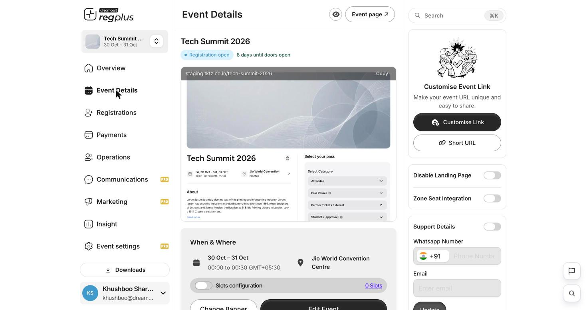

**In short:** Your event page is the link guests use to sign up. Preview it, tidy up the link, then share it anywhere.

## Preview your page

Click **Event page** at the top right to see exactly what guests see — banner, dates, venue, the About story and the pass selector.

<Frame caption="The live event page a guest sees.">
  
</Frame>

## Copy and tidy the link

On your **Overview** (or **Event Details**), use **Copy Event Link** to grab your event's web address. You can also:

- **Customise Link** — set a clean, memorable slug instead of the default.
- **Short URL** — generate a shortened link for places with tight character limits.

<Frame caption="The event link and sharing controls.">
  
</Frame>

## Share it

Share the link on WhatsApp, social media, email or your website — anyone with it can register. The Overview's invite panel also has a **QR code** and one-tap share buttons.

<Tip>
  Want to track which channel brings sign-ups, or put the form on your own site? Use **tracked links and embeds** — see [Promote & track your event](/regplus/how-to-marketing).
</Tip>

<Note>
  Do a **test sign-up** yourself before you share widely. Check the form, the price at checkout and the confirmation message all look right.
</Note>

## FAQs

<AccordionGroup>
  <Accordion title="Can I get a cleaner web address?">
    Yes — use **Customise Link** for a memorable slug, and **Short URL** when you need something tiny for print or ads.
  </Accordion>

  <Accordion title="I only want invited people to register.">
    Turn off the public page with **Disable Landing Page** in Event Details, and bring guests in by invite. See [Set up your event page](/regplus/how-to-event-page).
  </Accordion>

  <Accordion title="How do I know people are actually registering?">
    Watch the **Overview** counts and the **Guests** list, or open the **Insight** reports for the full picture.
  </Accordion>
</AccordionGroup>

## What's next?

<CardGroup cols={2}>
  <Card title="Send invitations & RSVPs" icon="envelope" href="/regplus/invitations-rsvp">
    Invite guests directly and track replies.
  </Card>

  <Card title="Insights & reports" icon="chart-line" href="/regplus/insights-reports">
    Watch sign-ups and revenue as they come in.
  </Card>
</CardGroup>
