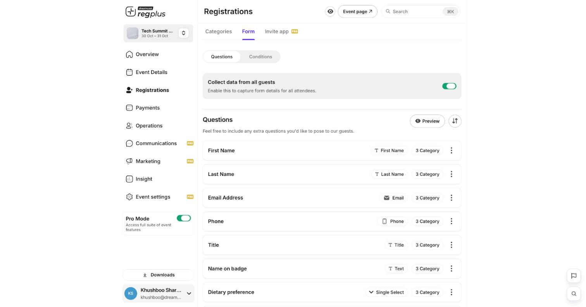
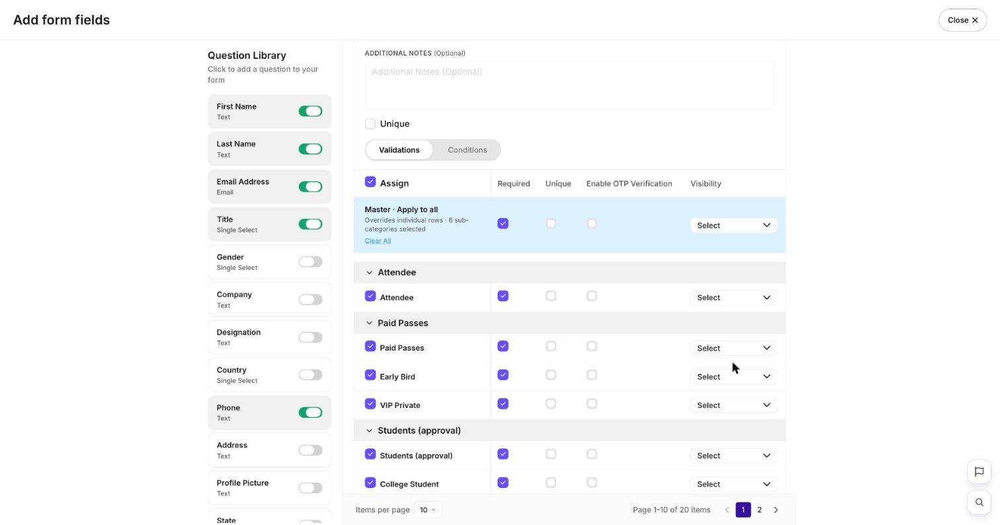
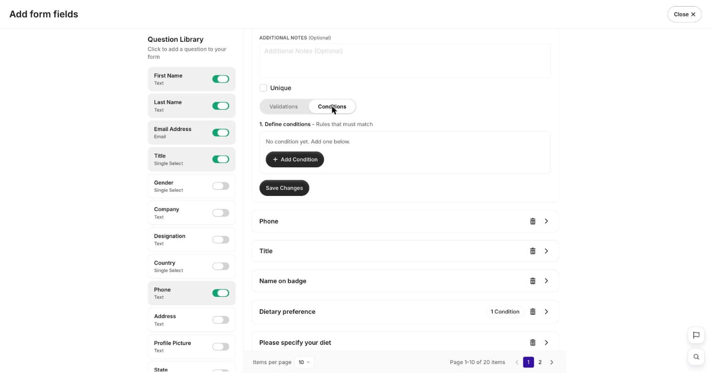

**In short:** Your form decides what guests fill in when they sign up. Ask only what you need, set how each answer is validated, and let questions adapt to each guest.

<Info>
  **Where to find it:** Open **Registrations** from the left menu and go to the **Form** tab. The form already asks for name, email and phone.
</Info>

## Add a question

<Frame caption="The Form tab — your questions, with the essentials already in place.">
  
</Frame>

Click **Add Questions**, pick a field from the library or add your own, and give it a label — for example a **Single Select** called _Attending as_ with options _In-person_ and _Virtual_.

<Frame caption="The field library — pick a question type.">
  
</Frame>

## Field types you can use

| Type | Good for |
| --- | --- |
| **Text / Long text** | Names, free comments. |
| **Single / Multi select** | Choose one or several from a list. |
| **Number** | Quantities, ages. |
| **Email / Phone** | Contact details, validated for format. |
| **Date** | Preferred day, date of birth. |
| **URL** | A link, e.g. a LinkedIn profile. |
| **File upload** | Documents or images a guest attaches. |

## Validations

Each question can carry rules so the data comes in clean:

- **Required** — the guest can't skip it.
- **Unique** — no two guests can give the same value (good for an ID number).
- **OTP** — verify an email or phone with a one-time code.
- **Visibility per ticket type** — show a question only for certain ticket types.

<Tip>
  Use **Master · Apply to all** to set a rule once and apply it across every ticket type, instead of repeating it on each.
</Tip>

## Show a question only when it applies

You can show or hide a question based on an earlier answer, so guests only see what's relevant to them.

<Frame caption="Conditions — show or hide a question based on an answer.">
  
</Frame>

1. Open the **Conditions** tab and click **Add Condition**.
2. Set the rule — for example: **if** _Attending as_ **is** _In-person_, **then show** _Dietary preference_.
3. **Save**, then open **Preview** and try each answer to check the form adapts.

<Note>
  Preview your form before you share your event. Pick each option once to make sure the right questions appear and nothing required is hidden.
</Note>

## FAQs

<AccordionGroup>
  <Accordion title="How do I stop two people registering with the same email?">
    Add the **Unique** validation to the email question — regplus then blocks a duplicate value.
  </Accordion>

  <Accordion title="Can different ticket types ask different questions?">
    Yes — set a question's **Visibility** to specific ticket types, or build conditions that depend on the pass chosen.
  </Accordion>

  <Accordion title="My conditional question never shows.">
    Re-check the condition's rule in **Preview**: the trigger answer must match exactly. Make sure the controlling question appears before the one it reveals.
  </Accordion>
</AccordionGroup>

## What's next?

<CardGroup cols={2}>
  <Card title="Build the form (detailed)" icon="list-check" href="/regplus/how-to-registration-form">
    The full field-by-field walkthrough.
  </Card>

  <Card title="Ticket types & pricing" icon="ticket" href="/regplus/ticket-types">
    Set up what guests sign up for.
  </Card>
</CardGroup>
