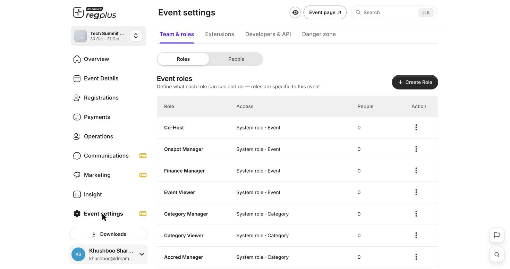
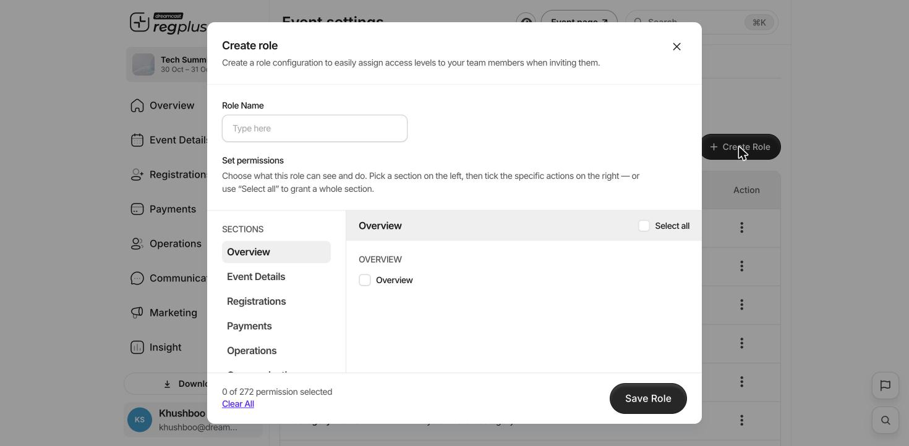

**In short:** A role decides what a team member can see and do. regplus comes with ready-made roles, and you can build your own for finer control. Set these up under **Event settings → Team & roles → Roles**.

## Ready-made roles

Every event starts with system roles you can assign straight away. Each works at a level — the whole **event**, or a single **ticket type** (category):

<Frame caption="The Event roles list with system roles and their scope.">
  
</Frame>

| Role | Scope | Good for |
| --- | --- | --- |
| **Co-Host** | Whole event | A trusted partner helping run everything. |
| **Onspot Manager** | Whole event | On-ground staff running check-in and badges. |
| **Finance Manager** | Whole event | Orders, payments and financial reports. |
| **Event Viewer** | Whole event | Read-only access for a stakeholder. |
| **Category Manager** | One ticket type | A sponsor managing just their ticket type. |
| **Category Viewer** | One ticket type | Read-only access to one ticket type. |
| **Accred Manager** | One ticket type | Accreditation for a specific ticket type. |

## Create a custom role

If the ready-made roles don't fit, build your own with exactly the access you want.

1. On the **Roles** tab, click **\+ Create Role**.
2. Give it a clear name, like _Help desk_ or _Sponsor liaison_.
3. Pick a section on the left (Overview, Event Details, Registrations, Payments, Operations, Communications, Marketing and more), then tick the exact actions this role should have. Use **Select all** to grant a whole section at once.
4. Click **Save Role** — it's now available to assign.

<Frame caption="Creating a custom role — sections and per-action permissions.">
  
</Frame>

<Tip>
  Give each person the **least** access they need. A finance colleague rarely needs to edit your registration form, and on-ground staff usually only need check-in.
</Tip>

## Assign a role

Roles are assigned when you invite someone on the **People** tab — see [Team access & roles](/regplus/team-access).

## FAQs

<AccordionGroup>
  <Accordion title="Can two roles be combined?">
    Assign the role that covers what the person needs, or build a **custom role** with exactly that mix of permissions.
  </Accordion>

  <Accordion title="A team member can see too much.">
    Change their role to a narrower one, or create a custom role that grants only the sections they need.
  </Accordion>
</AccordionGroup>

## What's next?

<CardGroup cols={2}>
  <Card title="Team access & roles" icon="user-group" href="/regplus/team-access">
    Invite colleagues and assign roles.
  </Card>

  <Card title="Advanced mode" icon="sliders" href="/regplus/advanced-mode">
    Unlock team roles and other tools.
  </Card>
</CardGroup>
