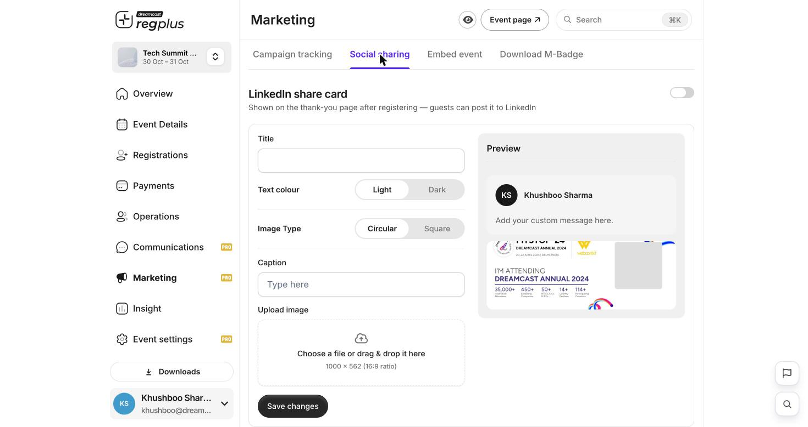

**In short:** Turn on a ready-made LinkedIn card that guests can share after they register — free promotion for your event from the people attending it.

<Info>
  **Where to find it:** Open **Marketing → Social sharing**.
</Info>

## Turn on the share card

Switch on the **LinkedIn share card**. Once it's on, guests see a _share to LinkedIn_ option on the thank-you page right after they register.

<Frame caption="The Social sharing tab — settings on the left, a live preview on the right.">
  
</Frame>

## Design the card

Use the settings on the left — the preview on the right updates as you go:

| Field | What it does |
| --- | --- |
| **Title** | The heading on the card. |
| **Text colour** | **Light** or **Dark**, so text stays readable on your image. |
| **Image type** | Show the guest's photo as a **circle** or **square**. |
| **Caption** | The default message with the post (guests can edit before sharing). |
| **Upload image** | The card background — use **1000 × 562 px** (16:9) for the best fit. |

Click **Save changes** when the preview looks right.

<Tip>
  Keep the caption short and add your event hashtag — it makes the post easy to share and easy to find.
</Tip>

## FAQs

<AccordionGroup>
  <Accordion title="Where do guests see the card?">
    On the **thank-you page** right after they register — they can post it to LinkedIn in one tap.
  </Accordion>

  <Accordion title="My image looks cropped.">
    Use a **1000 × 562 px** (16:9) image so it fits the card without cropping.
  </Accordion>
</AccordionGroup>

## What's next?

<CardGroup cols={2}>
  <Card title="Embed your event" icon="code" href="/regplus/embed-event">
    Add your event to your own website.
  </Card>

  <Card title="Track where sign-ups come from" icon="link" href="/regplus/tracking-links">
    Use tracking links to see what's working.
  </Card>
</CardGroup>
