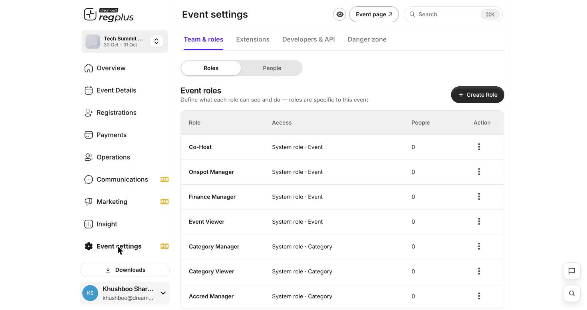

**In short:** Invite colleagues to help run your event and give each the right access, so your team works together without sharing one login.

<Info>
  **Where to find it:** Open **Event settings → Team & roles**. The **Roles** tab defines what each role can do; the **People** tab is where you invite members.
</Info>

## The roles available

<Frame caption="Event roles — ready-made roles, each scoped to the event or a ticket type.">
  
</Frame>

Every event comes with ready-made roles you can assign straight away — **Co-Host**, **Onspot Manager**, **Finance Manager**, **Event Viewer**, **Category Manager**, **Category Viewer** and **Accred Manager**. Full detail in [Roles & permissions](/regplus/roles-permissions).

## Add a team member

1. Go to the **People** tab and click **Invite Member**.
2. Enter your colleague's email and choose their role.
3. Send the invite — they get access once they accept, with their own login scoped to that role.

| Field | What to enter |
| --- | --- |
| **Email** | The colleague's email — this becomes their login. |
| **Role** | What they're allowed to do (see the roles above). |

<Tip>
  Give each person the **least** access they need. A sponsor managing one ticket type should be a **Category Manager**, not a Co-Host.
</Tip>

## FAQs

<AccordionGroup>
  <Accordion title="Do I need a separate login for each person?">
    No — invite them by email and they get their own login, scoped to their role. Never share your own login.
  </Accordion>

  <Accordion title="Can someone manage just one ticket type?">
    Yes — invite them as a **Category Manager** scoped to that ticket type.
  </Accordion>

  <Accordion title="How do I give read-only access?">
    Use the **Event Viewer** role for the whole event, or **Category Viewer** for one ticket type.
  </Accordion>
</AccordionGroup>

## What's next?

<CardGroup cols={2}>
  <Card title="Roles & permissions" icon="user-lock" href="/regplus/roles-permissions">
    Build a custom role with exactly the access you want.
  </Card>

  <Card title="Event settings & team (detailed)" icon="gear" href="/regplus/how-to-event-settings">
    The full event-settings walkthrough.
  </Card>
</CardGroup>
