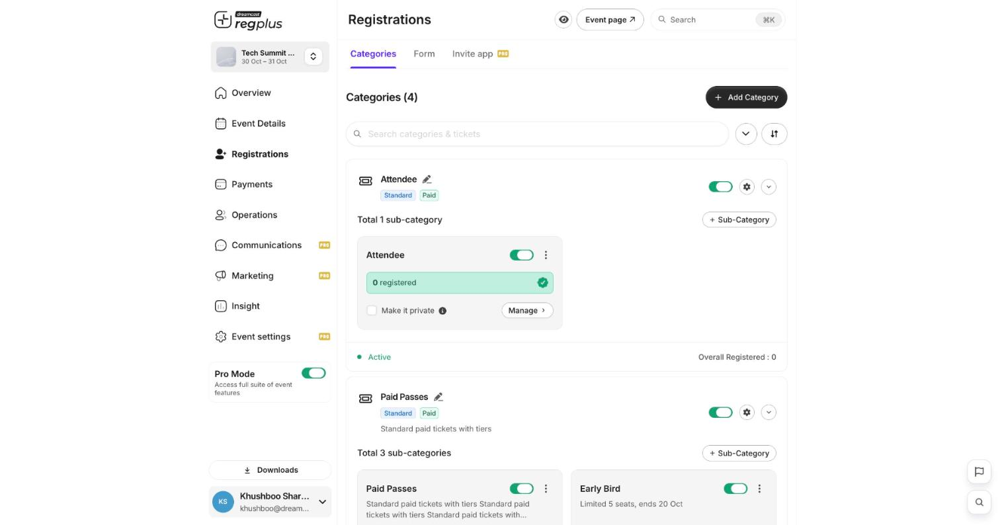
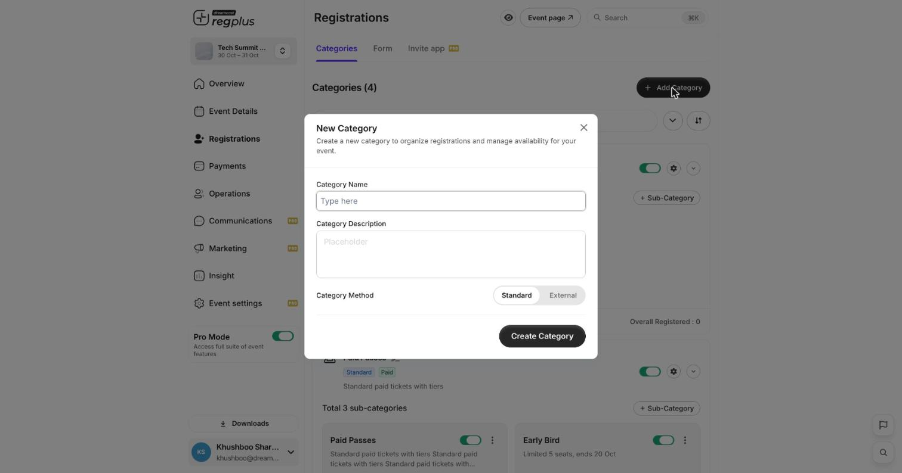
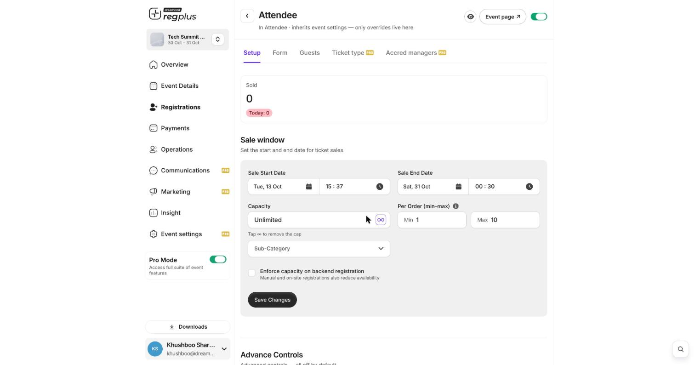

**In short:** A ticket type is what people sign up for — for example _Delegate_ or _VIP_. Inside each you add options, set a price, control how many can sell, and choose when it's on sale.

<Info>
  **Where to find it:** Open **Registrations** from the left menu. The **Categories** tab holds your ticket types.
</Info>

## How ticket types are structured

regplus uses two levels, which guests simply see as a category and the passes inside it:

| Level | What it is |
| --- | --- |
| **Category** | The top-level ticket type — _Attendee_, _Paid Passes_, _Students_. |
| **Sub-category** | An option inside it — _Early Bird_, _Regular_, _VIP_ — each with its own price and rules. |

<Frame caption="Registrations — categories with their sub-categories.">
  
</Frame>

## Add a ticket type

1. Click **\+ Add Category** and name your ticket type.
2. Choose whether it's **Standard** or **Paid**, and add a short description.

<Frame caption="Adding a new category.">
  
</Frame>

3. Click **\+ Sub-Category** to add an option inside it. Set it free, or switch on **Paid** and enter a price.

## Set price, sale window and capacity

Open a sub-category's **Manage → Setup** to control how it sells:

<Frame caption="A ticket option's setup — sale window, capacity and per-order limits.">
  
</Frame>

| Setting | What it does |
| --- | --- |
| **Sale Start / End Date** | The window this option is on sale. Use it for early-bird pricing — an early option that closes, and a regular option that opens after. |
| **Capacity** | How many can sell. Leave **Unlimited**, or tap the ∞ to set a cap. |
| **Per Order (min–max)** | The smallest and largest quantity in one order. |
| **Enforce capacity on backend registration** | Count manual and on-site registrations against the cap too. |

## Sell a private ticket

Turn on **Make it private** on a sub-category to hide it from your main event page. Only people with the private link can see and book it — useful for sponsors or special guests.

<Note>
  For paid tickets, turn on payments first, or guests won't be able to pay. See [Turn on payments](/regplus/payments).
</Note>

## FAQs

<AccordionGroup>
  <Accordion title="How do I run early-bird pricing?">
    Create two options — an _Early Bird_ with a sale **end** date, and a _Regular_ with a sale **start** date right after. The regular one takes over automatically when early-bird closes.
  </Accordion>

  <Accordion title="Can I limit how many tickets one person buys?">
    Yes — set **Per Order (min–max)** on the option. The max is the most a single order can include.
  </Accordion>

  <Accordion title="I set a capacity but on-site registrations ignore it.">
    Turn on **Enforce capacity on backend registration** so manual and walk-in registrations also reduce availability.
  </Accordion>

  <Accordion title="How do I give each pass a different price online vs at the door?">
    Use the advanced **Ticket type** tab — see [Advanced ticket & accreditation](/regplus/how-to-ticket-advanced).
  </Accordion>
</AccordionGroup>

## What's next?

<CardGroup cols={2}>
  <Card title="Turn on payments" icon="credit-card" href="/regplus/payments">
    Collect money for paid tickets.
  </Card>

  <Card title="Create a discount code" icon="tag" href="/regplus/discounts">
    Give guests money off at checkout.
  </Card>
</CardGroup>
