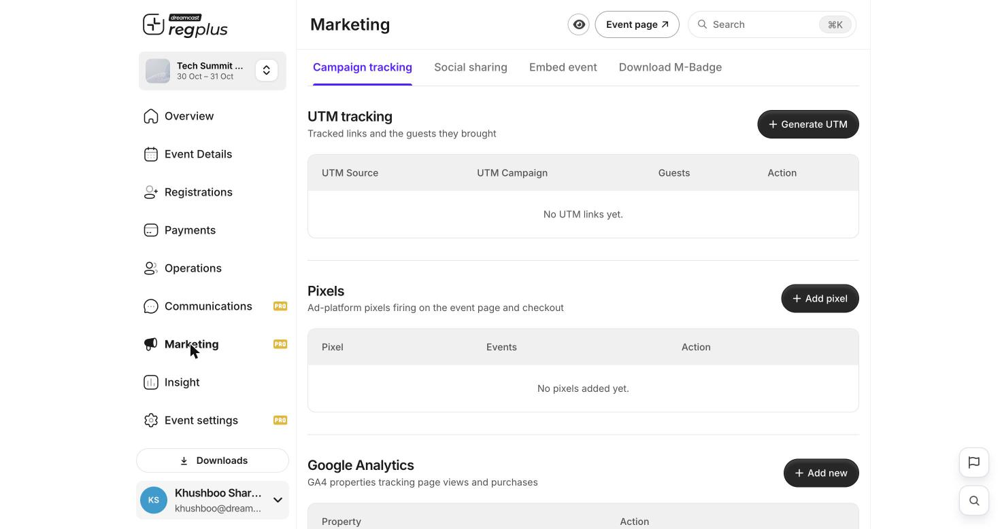
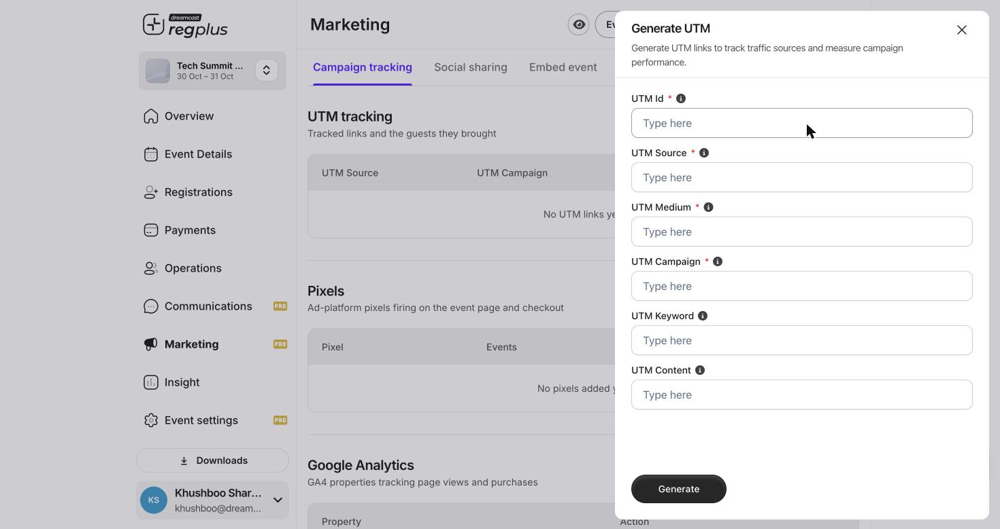

**In short:** A tracking link is your event link with tags on the end, so you can tell which post, email or ad a registration came from. You make one in **Marketing** and share it instead of your plain event link.

<Info>
  **Where to find it:** Open **Marketing** from the left menu, on the **Campaign tracking** tab.
</Info>

<Frame caption="Campaign tracking — UTM links, pixels and analytics in one place.">
  
</Frame>

## Make a tracking link

Click **Generate UTM** and fill in the tags.

<Frame caption="The Generate UTM form.">
  
</Frame>

| Tag | What to enter |
| --- | --- |
| **UTM Id** | A name so you can find the link in the list. |
| **UTM Source** | Where it lives — `newsletter`, `instagram`, `google`. |
| **UTM Medium** | The channel type — `email`, `social`, `cpc`. |
| **UTM Campaign** | The campaign name — `early-bird`. |
| **UTM Keyword / Content** | Optional — the paid keyword, or which creative. |

Copy the generated link and share it in that place instead of your normal event link.

## See the results

The UTM tracking table shows the **guests each link brought**, and the [Marketing & Traffic report](/regplus/insight-marketing) breaks it down further — so you can see which channels are worth your time.

<Note>
  Make a **separate** link for each place you share your event. One link for everything can't tell you what's working.
</Note>

## FAQs

<AccordionGroup>
  <Accordion title="My report shows no sources.">
    You're sharing the plain event link. Generate a UTM link here and share that instead.
  </Accordion>

  <Accordion title="How many links should I make?">
    One per channel and campaign — e.g. a separate link for your newsletter, your Instagram bio and each ad — so you can compare them.
  </Accordion>
</AccordionGroup>

## What's next?

<CardGroup cols={2}>
  <Card title="Connect an ad pixel" icon="meta" href="/regplus/meta-pixel">
    Run ads and track sign-ups from them.
  </Card>

  <Card title="Promote & track your event (detailed)" icon="bullhorn" href="/regplus/how-to-marketing">
    The full marketing walkthrough.
  </Card>
</CardGroup>
